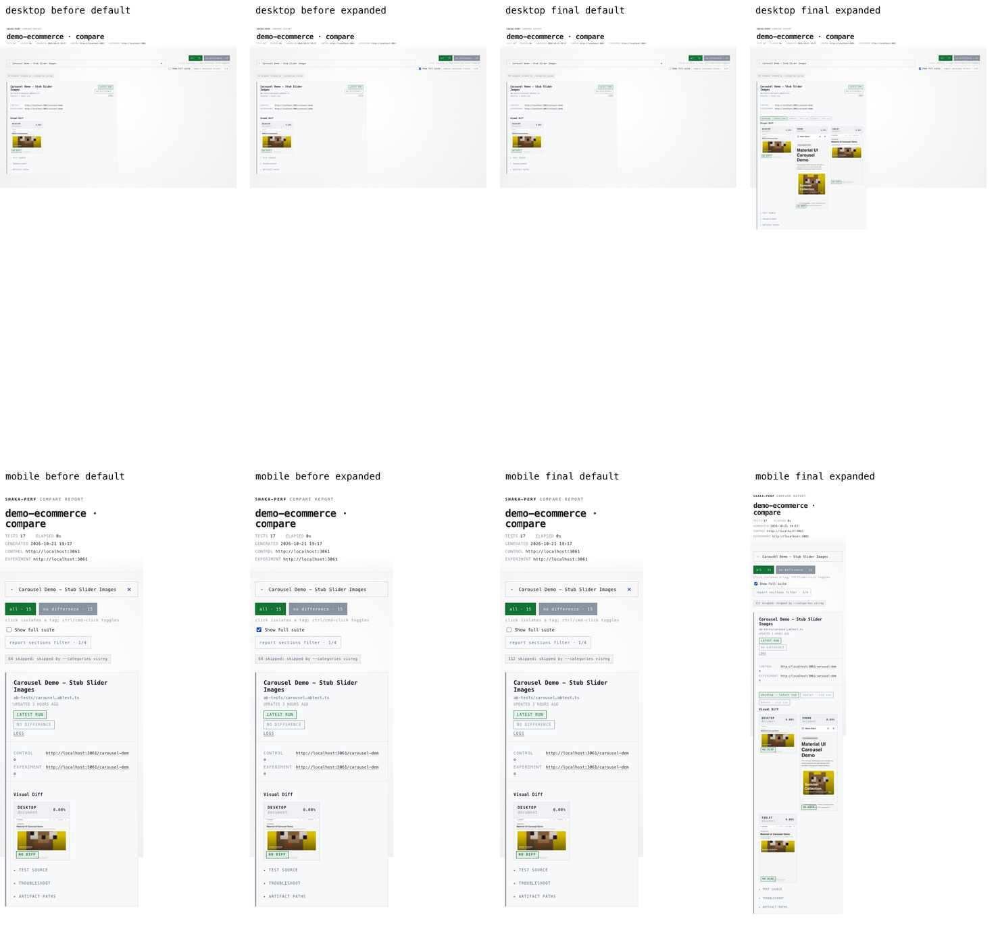
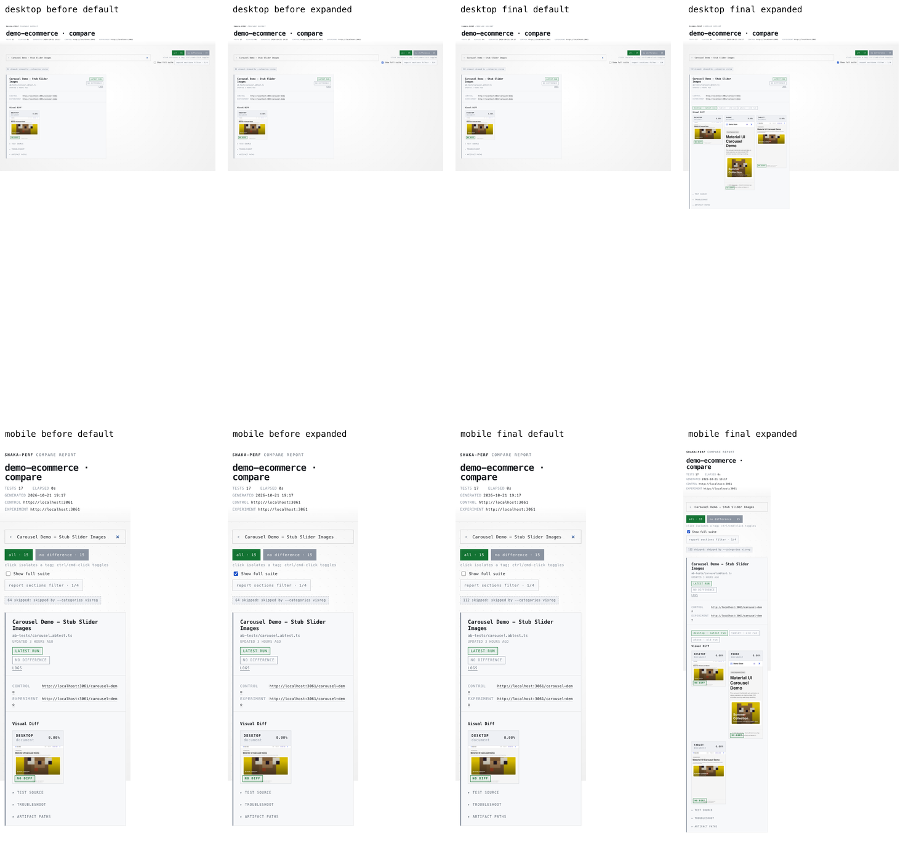
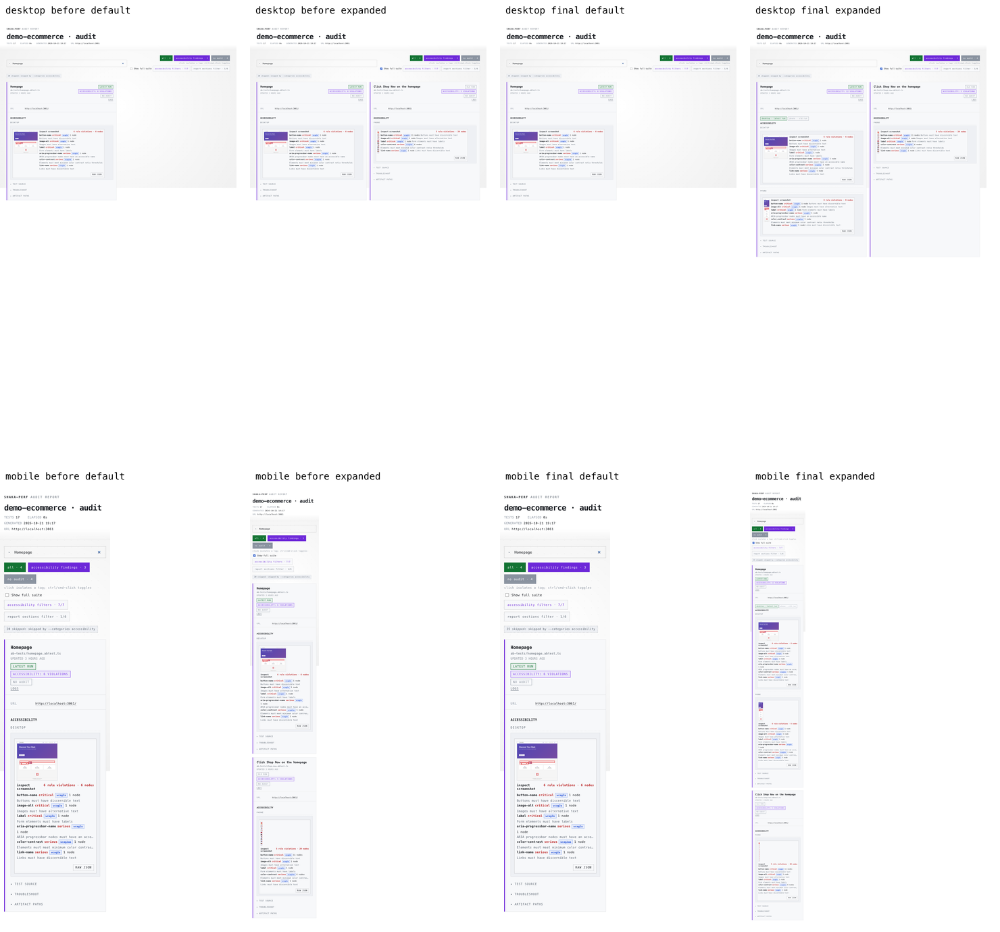
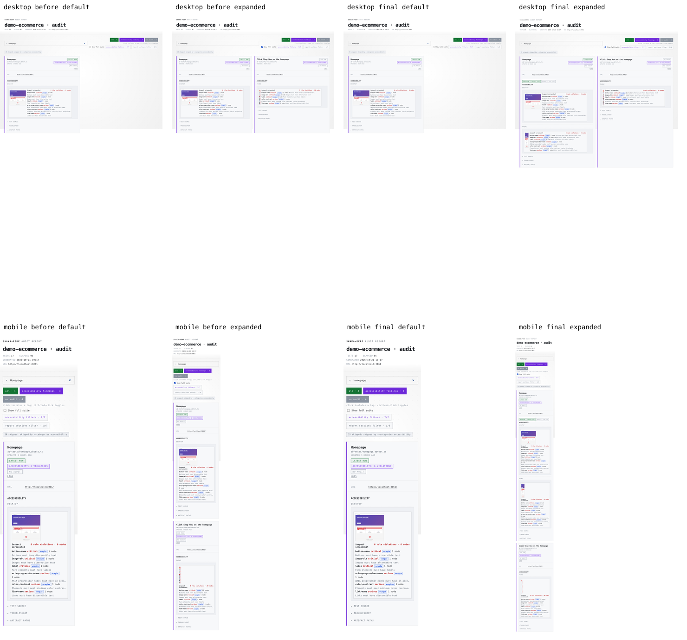

# Report visibility screenshot walkthrough

Matched real demo ecommerce results: full suite, phone rerun, desktop rerun, then report-only with and without filters. Compare visreg and audit accessibility use real test definitions and saved JSON. Before/after pairs share identical data, artifacts, run histories, and viewport sizes.

Baseline: 168ea518f9b2d453e3e95e78f87e4e7e879f2bc9. Candidate UI: 34e4c9b702634cb2b53dd22cf50aa23e8c3d55b1, unchanged in rebased c0018647274eff3286d6e17a9b6571f9693c9c0b (verified by Git diff). Desktop 1440x1000, mobile 390x1000; full-page PNGs. Relative age text can round across minute boundaries.

Default views respect configured desktop results and latest measurement cards. Expanded views reveal saved phone/tablet outcomes with old-run labels. Search targets Carousel Demo - Stub Slider Images for compare and Homepage for audit, identically in each pair.

Contact sheets: top row desktop, bottom row mobile. Columns: baseline default, baseline expanded, fixed default, fixed expanded. Full-size originals are linked below each sheet.

## compare / full

- [desktop before default](viewport-before-compare-full-desktop-default.png)
- [desktop before expanded](viewport-before-compare-full-desktop-expanded.png)
- [desktop final default](viewport-final-compare-full-desktop-default.png)
- [desktop final expanded](viewport-final-compare-full-desktop-expanded.png)
- [mobile before default](viewport-before-compare-full-mobile-default.png)
- [mobile before expanded](viewport-before-compare-full-mobile-expanded.png)
- [mobile final default](viewport-final-compare-full-mobile-default.png)
- [mobile final expanded](viewport-final-compare-full-mobile-expanded.png)

## compare / self-contained

- [desktop before default](viewport-before-compare-self-contained-desktop-default.png)
- [desktop before expanded](viewport-before-compare-self-contained-desktop-expanded.png)
- [desktop final default](viewport-final-compare-self-contained-desktop-default.png)
- [desktop final expanded](viewport-final-compare-self-contained-desktop-expanded.png)
- [mobile before default](viewport-before-compare-self-contained-mobile-default.png)
- [mobile before expanded](viewport-before-compare-self-contained-mobile-expanded.png)
- [mobile final default](viewport-final-compare-self-contained-mobile-default.png)
- [mobile final expanded](viewport-final-compare-self-contained-mobile-expanded.png)

## audit / full

- [desktop before default](viewport-before-audit-full-desktop-default.png)
- [desktop before expanded](viewport-before-audit-full-desktop-expanded.png)
- [desktop final default](viewport-final-audit-full-desktop-default.png)
- [desktop final expanded](viewport-final-audit-full-desktop-expanded.png)
- [mobile before default](viewport-before-audit-full-mobile-default.png)
- [mobile before expanded](viewport-before-audit-full-mobile-expanded.png)
- [mobile final default](viewport-final-audit-full-mobile-default.png)
- [mobile final expanded](viewport-final-audit-full-mobile-expanded.png)

## audit / self-contained

- [desktop before default](viewport-before-audit-self-contained-desktop-default.png)
- [desktop before expanded](viewport-before-audit-self-contained-desktop-expanded.png)
- [desktop final default](viewport-final-audit-self-contained-desktop-default.png)
- [desktop final expanded](viewport-final-audit-self-contained-desktop-expanded.png)
- [mobile before default](viewport-before-audit-self-contained-mobile-default.png)
- [mobile before expanded](viewport-before-audit-self-contained-mobile-expanded.png)
- [mobile final default](viewport-final-audit-self-contained-mobile-default.png)
- [mobile final expanded](viewport-final-audit-self-contained-mobile-expanded.png)

